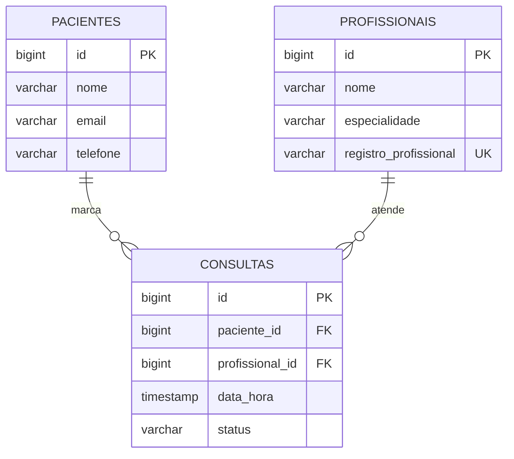

# Modelo de domínio

## Entidades

### Profissional

Um profissional de saúde da clínica, que atende os pacientes.

| Atributo | Tipo Java | Coluna | Obrigatório | Regra |
|---|---|---|---|---|
| `id` | `Long` | `id` | sim | Gerado pelo banco |
| `nome` | `String` | `nome` | sim | Até 255 caracteres |
| `especialidade` | `String` | `especialidade` | sim | Até 100 caracteres. É por ela que a regra R2 agrupa as consultas do paciente |
| `registroProfissional` | `String` | `registro_profissional` | sim | Até 30 caracteres. É único: o registro no conselho (como `CRM-SC 48213`) identifica o profissional |

### Paciente

Uma pessoa cadastrada na clínica, que pode marcar consultas.

| Atributo | Tipo Java | Coluna | Obrigatório | Regra |
|---|---|---|---|---|
| `id` | `Long` | `id` | sim | Gerado pelo banco |
| `nome` | `String` | `nome` | sim | Até 255 caracteres |
| `email` | `String` | `email` | sim | Formato de e-mail válido, até 255 caracteres. Não é único |
| `telefone` | `String` | `telefone` | sim | Só números, 10 ou 11 dígitos (DDD + número) |

### Consulta

A marcação de um paciente com um profissional, num dia e horário.

| Atributo | Tipo Java | Coluna | Obrigatório | Regra |
|---|---|---|---|---|
| `id` | `Long` | `id` | sim | Gerado pelo banco |
| `paciente` | `Paciente` | `paciente_id` | sim | O paciente precisa existir. Vale a regra R2 |
| `profissional` | `Profissional` | `profissional_id` | sim | O profissional precisa existir. Vale a regra R1 |
| `dataHora` | `LocalDateTime` | `data_hora` | sim | Precisa estar no futuro e dentro do expediente (R3) |
| `status` | `StatusConsulta` | `status` | sim | Nasce `AGENDADA`; muda para `CANCELADA` (R4) ou `REALIZADA`. O cliente não controla |

`StatusConsulta` é um enum com três valores: `AGENDADA`, `CANCELADA` e `REALIZADA`. O banco garante isso com um `CHECK`. Só uma consulta `AGENDADA` pode ser cancelada ou concluída; `CANCELADA` e `REALIZADA` são estados finais.

## Relacionamentos

| De | Para | Tipo | No banco | No código |
|---|---|---|---|---|
| Consulta | Paciente | muitos para um | `consultas.paciente_id` referencia `pacientes(id)` | `@ManyToOne` em `Consulta` |
| Consulta | Profissional | muitos para um | `consultas.profissional_id` referencia `profissionais(id)` | `@ManyToOne` em `Consulta` |

Entre `Paciente` e `Profissional` o relacionamento é muitos para muitos: um paciente pode ser atendido por vários profissionais, e um profissional atende vários pacientes. A tabela `consultas` resolve isso e ainda guarda o horário e a situação do atendimento.

## Diagrama ER

Como ler: `||--o{` é "um para muitos". Um paciente marca zero ou várias consultas, e cada consulta é de exatamente um paciente. O mesmo vale para profissional e consulta.

## Onde as regras atuam no modelo

| Regra | O que olha no modelo | Onde é garantida |
|---|---|---|
| R1: o profissional não pode ter duas consultas agendadas no mesmo horário | `profissional_id` + `data_hora` das consultas `AGENDADA` | `ConsultaService.agendar` e o índice único parcial `uk_consultas_profissional_horario` (V3), que só vale para `AGENDADA`: o horário de uma consulta cancelada volta a ficar livre |
| R2: o paciente só pode ter uma consulta agendada por especialidade | `paciente_id` + `especialidade` do profissional, nas consultas `AGENDADA` | `ConsultaService.agendar` |
| R3: atendimento de segunda a sexta, das 08:00 às 18:00, de 30 em 30 minutos | `data_hora` | `ConsultaService.agendar` (método `dentroDoExpediente`) |
| R4: cancelamento com pelo menos 2 horas de antecedência | `data_hora` e `status` | `ConsultaService.cancelar` |

## Migrations

Todas existem em `src/main/resources/db/migration`, uma tabela por arquivo.

| Versão | Arquivo | O que cria |
|---|---|---|
| V1 | `V1__criar_profissionais.sql` | Tabela `profissionais`, com `registro_profissional` único |
| V2 | `V2__criar_pacientes.sql` | Tabela `pacientes` |
| V3 | `V3__criar_consultas.sql` | Tabela `consultas`, com as duas chaves estrangeiras, o `CHECK` do status e o índice único parcial da regra R1 |
